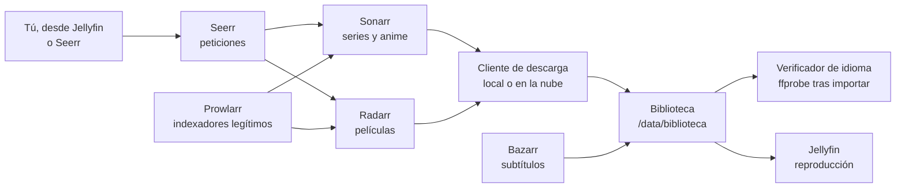

# Personal Media ARR

**Guía para montar un servidor multimedia doméstico con Sonarr, Radarr, Prowlarr, Bazarr, Jellyfin y Seerr, pensado para contenido en castellano y anime en japonés con subtítulos en español, sin descargar nada al disco del servidor si no quieres y sin salirse de la ley.**

Este repositorio documenta un montaje real sobre un NAS: qué hace cada pieza, cómo se conectan, qué se rompió al ponerlo en marcha, qué hubo que inventar porque las aplicaciones no lo traen y qué falta todavía para que funcione de verdad solo.

[El stack](docs/00-el-stack.md) · [Marco legal](docs/01-marco-legal.md) · [Arquitectura](docs/02-arquitectura.md) · [Plugins de Jellyfin](docs/06-plugins-jellyfin.md) · [Lo que falta](docs/09-lo-que-falta.md)

---

## Antes de empezar: qué es y qué no es

Sonarr, Radarr y compañía son gestores de biblioteca. Vigilan qué series y películas quieres, buscan en las fuentes que **tú** configuras, mandan la descarga a un cliente, renombran y ordenan. No traen contenido. Qué entra en tu biblioteca depende por completo de las fuentes que les des.

Esta guía solo cubre fuentes legítimas: tus propios discos, obras de dominio público o con licencia libre, y servicios o indexadores a los que tengas derecho a acceder para ese contenido. No enlaza, recomienda ni explica cómo usar trackers o agregadores de contenido sin licencia. El [marco legal](docs/01-marco-legal.md) lo detalla.

> **Sobre los datos.** No aparecen dominios, direcciones IP, cuentas, claves ni la topología real del servidor. Los ejemplos usan `example.com` y nombres genéricos. Ningún secreto aparece en estos ficheros, ni siquiera caducado.

## En una imagen



## Estado

| | |
|---|---|
| Situación | Montado, probado de extremo a extremo y retirado del NAS tras documentarlo |
| Hardware de referencia | CPU de 6 núcleos, 32 GB de RAM, ZFS en espejo, gráfica integrada para transcodificar |
| Sistema | TrueNAS SCALE con Docker Compose |
| Contenedores del ejemplo | 8: seis aplicaciones base, `langguard` y un cliente de descarga a elegir |
| Memoria del stack | Unos 2,2 GB en reposo |
| Exposición | Solo red local y DNS local; ninguna aplicación de gestión publicada en internet |
| Idiomas | Pelis y series en castellano, anime en japonés con subtítulos en español |

## Cómo leer esta documentación

| # | Documento | De qué va |
|---|---|---|
| 0 | [El stack](docs/00-el-stack.md) | Qué hace cada aplicación y por qué está |
| 1 | [Marco legal](docs/01-marco-legal.md) | Qué fuentes puedes usar y cuáles no |
| 2 | [Arquitectura](docs/02-arquitectura.md) | Rutas, redes, montajes y flujo de una petición |
| 3 | [Despliegue](docs/03-despliegue.md) | De cero a todo arrancado |
| 4 | [Configuración](docs/04-configuracion.md) | Prowlarr, Sonarr, Radarr, Bazarr, Jellyfin y Seerr, paso a paso |
| 5 | [Idioma](docs/05-idioma.md) | Castellano frente a latino, anime en japonés y el verificador |
| 6 | [Plugins de Jellyfin](docs/06-plugins-jellyfin.md) | Seerr dentro de Jellyfin y el resto de plugins que merecen la pena |
| 7 | [Seguridad](docs/07-seguridad.md) | Exposición, credenciales, telemetría y límites |
| 8 | [Tropiezos](docs/08-tropiezos.md) | Lo que falló al montarlo, en formato postmortem |
| 9 | [Lo que falta](docs/09-lo-que-falta.md) | Qué faltaría para un stack perfecto y qué no resuelven todavía las aplicaciones |
| 10 | [Otros idiomas](docs/10-otros-idiomas.md) | Cómo hacer lo mismo en inglés, francés, alemán o cualquier otro |
| - | [Registro de decisiones](docs/decisiones/README.md) | Las decisiones importantes, una por fichero |

Si solo tienes cinco minutos: este README, [el marco legal](docs/01-marco-legal.md) y [lo que falta](docs/09-lo-que-falta.md).

## Qué trae el repositorio

| Carpeta | Contenido |
|---|---|
| `docs/` | La guía completa y el registro de decisiones |
| `deploy/` | `compose.yaml` de ejemplo, endurecido, con `.env.example` |
| `tools/langguard/` | Verificador de idioma y rescate de importaciones: webhook para Sonarr y Radarr con sus pruebas |
| `.github/` | Integración continua (pruebas y validación del compose) y Dependabot |

```bash
git clone https://github.com/IvelianK/Personal-Media-ARR.git
```

## Stack

| Capa | Tecnología |
|---|---|
| Gestión de biblioteca | Sonarr (series y anime), Radarr (películas) |
| Indexadores | Prowlarr |
| Peticiones | Seerr |
| Reproducción | Jellyfin con aceleración por hardware |
| Subtítulos | Bazarr |
| Descarga | Cliente local o servicio en la nube compatible con la API de qBittorrent |
| Calidad de idioma | Formatos personalizados propios y `langguard` |
| Borde | Proxy inverso con TLS y DNS local |

## Cinco ideas que resumen el proyecto

1. Las aplicaciones *arr deciden el idioma leyendo el nombre del fichero. Si el nombre miente o calla, la biblioteca se llena de audio equivocado. La única prueba fiable es abrir el fichero y mirar sus pistas.
2. "Castellano" y "Spanish" no son lo mismo. Ningún programa del stack distingue España de Latinoamérica sin ayuda.
3. Un enlace simbólico de 4 KB puede ser una película de 30 GB. Útil, pero cualquier lectura colgada de ese montaje puede bloquear un contenedor entero.
4. La mitad de los fallos no estaban en el stack: un cable a 100 Mb/s, la caché de ZFS empujando apps al swap, bloqueos de IP del proveedor de internet.
5. Legal no significa limitado. Tus discos, el dominio público y las bibliotecas abiertas dan para una colección enorme, y el stack funciona exactamente igual.

## Autor

Diseñado, montado y documentado por [Ivelian](https://github.com/IvelianK). También en este perfil: [Kura](https://github.com/IvelianK/Kura), la documentación del servidor doméstico donde se probó, y [Kintsugi](https://github.com/IvelianK/Kintsugi).

## Licencia

Documentación bajo [CC BY 4.0](https://creativecommons.org/licenses/by/4.0/deed.es). Código de `deploy/`, `tools/` y `.github/` bajo MIT. Detalle en [LICENSE](LICENSE).
