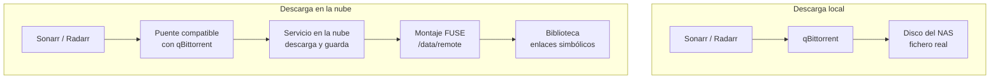

# 0. El stack

Ocho contenedores en el ejemplo de Docker Compose: seis aplicaciones base, `langguard` y un cliente de descarga a elegir. El normalizador Torznab es una posibilidad de diseño que no viene implementada.

| Aplicación | Para qué | Puerto interno | Memoria en reposo |
|---|---|---|---|
| Prowlarr | Gestiona los indexadores una sola vez y los reparte a Sonarr y Radarr | 9696 | ~150 MB |
| Sonarr | Series y anime: vigila, busca, manda descargar, renombra | 8989 | ~240 MB |
| Radarr | Lo mismo para películas | 7878 | ~220 MB |
| Bazarr | Busca subtítulos en español para lo que ya está en la biblioteca | 6767 | ~200 MB |
| Jellyfin | El reproductor: bibliotecas, usuarios, apps de TV y móvil | 8096 | ~570 MB |
| Seerr | Portal de peticiones: buscas un título, le das a "Pedir" y llega solo | 5055 | ~190 MB |
| Cliente de descarga | Local (qBittorrent) o en la nube (un puente compatible con su API) | 8080 / 8282 | ~50-580 MB |
| `langguard` | Comprueba el idioma real de cada fichero importado y rescata importaciones atascadas | 8080, solo en la red interna | ~30 MB |
| Normalizador Torznab (no incluido) | Diseño para reescribir nombres que las *arr no saben interpretar | Sin puerto asignado | Sin medición |

## Qué hace cada uno, en una frase

- **Prowlarr** es la agenda de fuentes. Añades un indexador ahí y aparece en Sonarr y Radarr sin tocarlos.
- **Sonarr y Radarr** son los que deciden. Comparan cada resultado con tu perfil de calidad, puntúan con los formatos personalizados y eligen.
- **El cliente de descarga** solo obedece. Sonarr y Radarr hablan con él por la API de qBittorrent, así que cualquier cosa que imite esa API sirve.
- **Bazarr** no descarga vídeo. Mira qué hay en la biblioteca y busca subtítulos para ello.
- **Jellyfin** lee la biblioteca y la sirve a los dispositivos. No sabe nada de Sonarr ni de Radarr; solo ve carpetas.
- **Seerr** es la cara amable. Habla con Jellyfin para saber qué ya tienes y con Sonarr y Radarr para pedir lo que falta.

## Lo que no está y por qué

| Pieza habitual | Por qué no |
|---|---|
| Lidarr, Readarr | Música y libros quedaban fuera del alcance |
| FlareSolverr | Ningún indexador legítimo de los usados lo necesitaba |
| VPN para el cliente de descarga | Depende de tus fuentes. Con un servicio en la nube no hay tráfico P2P desde casa; con un cliente local y fuentes públicas, es recomendable |
| Recyclarr o Profilarr | Útiles, pero las guías que sincronizan no tienen perfiles en castellano. Los formatos se crearon a mano por API ([Idioma](05-idioma.md)) |
| Overseerr, Jellyseerr | Ambos sustituidos por Seerr, que los une y es el que sigue mantenido |

## Dos formas de descargar

El montaje probado usaba la segunda: nada ocupa disco en el NAS y lo que el servicio ya tiene llega en segundos. A cambio, depende de un tercero, de su API y de tu conexión. La [arquitectura](02-arquitectura.md) explica las dos y el [registro de decisiones](decisiones/0001-enlaces-no-ficheros.md) por qué se eligió esa.

---

Siguiente: [Marco legal](01-marco-legal.md) · Volver al [inicio](../README.md)
