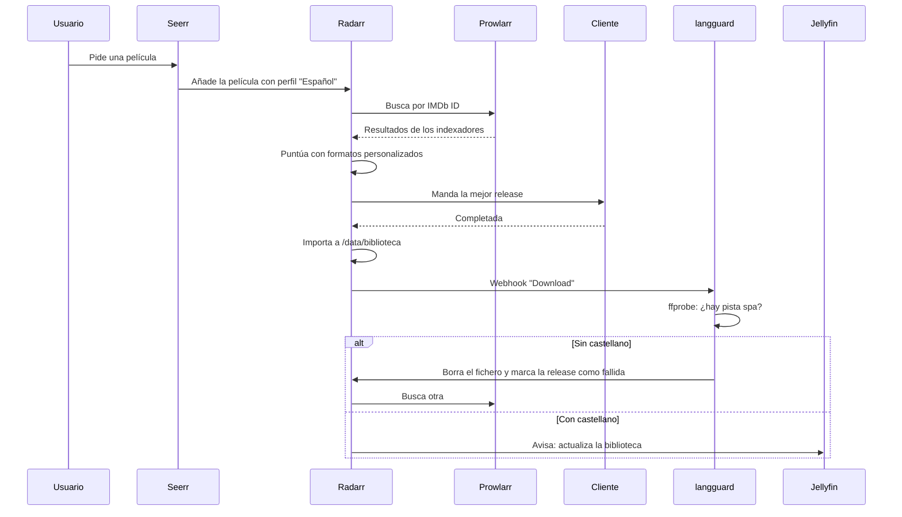
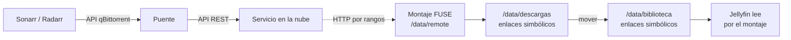

# 2. Arquitectura

## Una sola carpeta, una sola ruta

Todo el stack vive en un dataset propio y cada contenedor lo monta **en la misma ruta interna**, `/data`. Es la regla que más problemas evita: Sonarr ve el fichero en `/data/descargas/...`, lo mueve a `/data/biblioteca/...`, y Jellyfin lo encuentra exactamente ahí.

```
media/                      dataset propio, montado como /data en todos
├── config/<app>/           configuración y base de datos de cada aplicación
├── biblioteca/
│   ├── peliculas/          Radarr
│   ├── series/             Sonarr, perfil "Español"
│   └── anime/              Sonarr, perfil "Anime"
├── descargas/              donde el cliente deja lo descargado
├── remote/                 montaje FUSE del servicio en la nube (si se usa)
└── cache/                  cachés de Jellyfin y del cliente
```

El `compose.yaml` y su `.env` (claves, permisos 600, fuera de git) van juntos en `deploy/`, fuera del dataset de medios. Así borrar o recrear la pila no toca los datos; para restaurarla hay que conservar también el despliegue y sus secretos por separado.

| Por qué así | En lugar de |
|---|---|
| Mover entre `descargas` y `biblioteca` es un renombrado instantáneo dentro del mismo sistema de ficheros | Montajes separados por app, que obligan a copiar |
| Un solo `PUID`/`PGID` para todo (`568`, el usuario de aplicaciones de TrueNAS) | Cada app con su usuario y permisos cruzados |
| El anime en su propia carpeta raíz | Un segundo Sonarr solo para anime. Bazarr solo admite un Sonarr ([decisión](decisiones/0004-anime-en-el-mismo-sonarr.md)) |

## Flujo de una petición



## Con descarga en la nube

El cliente es un puente que imita la API de qBittorrent. Recibe el magnet de Sonarr o Radarr, lo pasa al servicio en la nube y monta el resultado como un sistema de ficheros FUSE en `/data/remote`. En `descargas/` crea **enlaces simbólicos** hacia ese montaje; Sonarr los mueve a la biblioteca como si fueran ficheros.



Detalles que importan:

- **Propagación de montajes.** El contenedor del puente monta `/data` con `rshared`; los demás con `rslave`. Si no, el montaje FUSE existe dentro del puente y los demás ven una carpeta vacía.
- **`/dev/fuse` y `SYS_ADMIN`.** El puente los necesita para montar. Es el único contenedor con privilegios extra; `init: true` ayuda a recoger procesos hijos, aunque un montaje FUSE bloqueado puede requerir intervención manual.
- **Los enlaces apuntan a `/data/remote/...`.** Desde el host esa ruta no existe. Para depurar, lee siempre desde dentro de un contenedor.
- **El ancho de banda real es el de tu conexión.** Un 4K remux ronda los 60-80 Mb/s. Con 100 Mb/s de enlace en el servidor no hay margen ([tropiezo](08-tropiezos.md#el-cable-de-100-mbs)).

## Redes

| Red o puerto | Quién | Para qué |
|---|---|---|
| Red `media` | Toda la pila | Que las apps se hablen por nombre (`http://sonarr:8989`). `langguard` solo está aquí |
| Puertos en `127.0.0.1` | Apps con interfaz web | Que el proxy inverso del host llegue a ellas sin exponerlas a la red |
| Puerto 8096 en la IP local (`JELLYFIN_BIND`) | Solo Jellyfin, si quieres | Apps de TV que buscan el servidor en la red local |

Ninguna aplicación de gestión escucha fuera de `127.0.0.1`. Se llega a ellas por el proxy inverso, con TLS y un nombre del DNS local. Si tu proxy corre en Docker, puedes unirlo a la red `media` y quitar los puertos.

## El normalizador Torznab

Sonarr y Radarr solo aceptan una release si entienden su nombre: título, año o número de episodio, calidad. Hay fuentes legítimas cuyos nombres no siguen ese formato (catálogos con el título traducido y sin año, o packs nombrados a mano).

Un normalizador es un servicio Torznab pequeño que se coloca entre la fuente y Prowlarr. Como la búsqueda llega con el IMDb ID, sabe qué título es cada resultado y puede reescribir el nombre:

| Nombre original | Nombre normalizado |
|---|---|
| `El Gran Clásico [1080p][Castellano]` | `The Great Classic 1954 1080p El Gran Clásico 1080p Castellano` |
| `Serie Temporada 1 completa [1080p]` | `Serie S01 1080p Serie Temporada 1 completa 1080p` |

Conserva el nombre original en medio, porque ahí van la fuente, el códec y el idioma, y antepone lo que las *arr necesitan. Tres reglas aprendidas a golpes:

1. **Un pack de temporada se anuncia como temporada (`S01`), no como episodio.** Si se anuncia como `S01E01`, Sonarr importa ese episodio y deja el resto en la carpeta.
2. **Las colecciones de películas se descartan.** Radarr no sabe importar varias películas de una sola descarga.
3. **Las series se etiquetan también con la categoría de anime (5070).** Sonarr busca el anime solo en esa categoría y Prowlarr filtra el resto.

Este repositorio no incluye un normalizador porque depende de cada fuente ([decisión 0005](decisiones/0005-solo-fuentes-legitimas.md)). El diseño completo es esta sección.

---

Anterior: [Marco legal](01-marco-legal.md) · Siguiente: [Despliegue](03-despliegue.md) · Volver al [inicio](../README.md)
