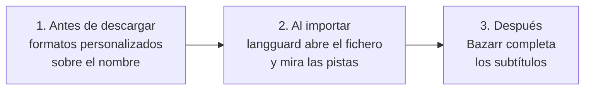

# 5. Idioma

El objetivo: películas y series con audio en **castellano** (no latino), anime con audio **japonés** y subtítulos en español. Ninguna aplicación del stack lo hace sola. Hacen falta tres capas.



## Por qué no basta con el nombre

- Sonarr y Radarr deciden el idioma **leyendo el nombre de la release**. No tienen otra cosa: el protocolo Torznab no trae las pistas de audio.
- Para ellos solo existe "Spanish". Un `ESP.LATINO` y un `Castellano` son lo mismo.
- Muchos nombres no dicen el idioma, o lo dicen mal: `ESP` lo usan releases latinas, y los catálogos que marcan idiomas con banderas suelen incluir también **los idiomas de los subtítulos**. Una release con subtítulos en español y audio solo en inglés lleva la bandera española igual.

Hubo dos casos reales mientras se montaba (los nombres aquí son ficticios): una release del estilo `Pelicula.2021.1080p.ENG.ITA.And.ESP.LATINO` cuya pista `spa` era latina, y otra marcada con 9 idiomas que solo tenía una pista de audio en inglés. Las dos pasaron el filtro por nombre. Las dos las paró el verificador.

## 1. Formatos personalizados

Se crean en Sonarr y Radarr (**Settings → Custom Formats**) con condiciones de tipo **Release Title**, que aceptan expresiones regulares sin distinguir mayúsculas.

| Formato | Condiciones | Para qué |
|---|---|---|
| Castellano | Título contiene `castellano\|\bspanish\b\|\bespa[nñ]ol\b\|\bspa\b\|\besp\b\|\[es[-\]]` | Indicio de audio en español en el nombre |
| Solo latino | Título contiene `\[LATINO\]\|\blatino\b\|\blatam\b` **y no** contiene `castellano\|\bcast\b\|\bcas\b\|\bes[-_]es\b\|\[es[-\]]\|spain\|espa[nñ]a` (ambas obligatorias) | Latino sin marca fuerte de castellano |
| Japonés | `\[JAPANESE\]\|\bjapanese\b\|\bjpn\b` | Audio original en anime |
| Subs español | `sub(s\|titulos?)?[ ._-]?esp\|spa[ ._-]?sub\|multi[ ._-]?subs?` | Anime con subtítulos en español o multi |
| Doblaje | `\b(dub\|dubbed\|doblad[oa]\|doblaje)\b` | Anime doblado |
| Reescalado | `re-?escal\|upscal\|\bAI[ ._-]?upscale` | Falsos 4K hechos a partir de 1080p |
| Extras | `\b(extras?\|ovas?\|specials?\|featurettes?\|bonus)\b` | Packs de extras que se cuelan en búsquedas de episodios |

Si usas un normalizador que añade etiquetas al nombre (por ejemplo `[CACHED]` para lo que ya está en el servicio en la nube), créale su formato y dale una puntuación positiva moderada.

> En las tablas de Markdown la barra vertical aparece escapada (`\|`). En Sonarr y Radarr escribe `|` a secas.
>
> La marca fuerte de castellano es la misma que usa `langguard` (`VARIANTS` en [langguard.py](../tools/langguard/langguard.py)). Si cambias una, cambia la otra. La de latino del verificador es más amplia (`latam`, `mexic`, `lat`) porque mira títulos de pista, que son cortos; en nombres de release esas palabras darían falsos positivos.

## Perfiles

Calidades permitidas en los dos: solo 1080p y 2160p (el filtro de 720p e inferiores lo hacen los perfiles, no la fuente). Corte en Bluray-1080p.

### Español (películas y series)

| Formato | Puntos |
|---|---|
| Castellano | +1000 |
| Ya en caché del servicio en la nube (si aplica) | +500 |
| Solo latino | -10000 |
| Reescalado | -10000 |
| Extras | -10000 |
| **Puntuación mínima** | **1000** |
| Puntuación de corte | 1500 |

La mínima de 1000 obliga a que el nombre diga castellano. En Radarr, el idioma del perfil va en **Any**: si pones "Spanish" ahí, choca con los formatos.

### Anime

| Formato | Puntos |
|---|---|
| Subs español | +200 |
| Japonés | +100 |
| Ya en caché (si aplica) | +500 |
| Doblaje | -10000 |
| Reescalado | -10000 |
| Extras | -10000 |
| **Puntuación mínima** | **0** |

"Solo latino" **no** va en el perfil de anime: en anime las etiquetas de idioma suelen referirse a los subtítulos, y penalizar latino tumbaba releases japonesas válidas con subtítulos múltiples.

## 2. langguard: verificar después de importar

Es un webhook pequeño ([código](../tools/langguard/)) que Sonarr y Radarr llaman en cada importación.

1. Recibe la ruta del fichero importado.
2. Lanza `ffprobe` y lee las pistas de audio: código de idioma y título de la pista.
3. Decide con estas reglas:
   - Exige `spa`, o `jpn` si la ruta está en la carpeta de anime.
   - Una pista cuyo título dice latino no cuenta como castellano.
   - Si el nombre de la release dice latino y no trae marca fuerte de castellano, solo cuenta una pista **rotulada** como castellano.
   - Pistas sin etiqueta de idioma (`und`): usa el nombre de la release como indicio. En anime exige una marca explícita de japonés y descarta doblajes; aun así, no puede demostrar el idioma real sin una etiqueta fiable.
4. Si no cumple: borra el fichero de la biblioteca, marca la release como fallida (va a la lista de bloqueo) y la app busca la siguiente sola. Si la importación era una **mejora**, no borra: la app ya quitó el fichero anterior y borrar el nuevo dejaría el título vacío. Solo bloquea la release y lo deja en el registro.

Con descarga en la nube, `ffprobe` solo lee las cabeceras: unos pocos MB, uno o dos segundos por fichero.

Lo que ve en su registro:

```
radarr: .../Pelicula (1999) Remux-1080p.mkv | exige=spa | pistas=[('eng', ''), ('spa', 'DDP5.1'), ...] | RECHAZADO
radarr: release ... marcada como fallida, se buscara otra
sonarr: .../Serie - S04E01 - Titulo HDTV-1080p.mkv | exige=spa | pistas=[('spa', 'Surround 5.1'), ('eng', 'Surround 5.1')] | OK
sonarr: .../Anime - S01E04 - Titulo Bluray-1080p.mkv | exige=jpn | pistas=[('jpn', 'DTS-HD MA 5.1'), ('eng', 'DTS-HD MA 5.1')] | OK
```

### El rescate de importaciones

`langguard` hace además una segunda cosa cada `RESCUE_INTERVAL` segundos (600 por defecto): revisa `/data/descargas` y busca carpetas que nadie ha importado. Pasan dos cosas que Sonarr y Radarr no resuelven solos:

- **Hash repetido.** Si un pack de temporada ya se usó para un episodio, Sonarr da por importada cualquier petición posterior del mismo hash y no procesa el resto de capítulos.
- **Nombres sin año.** Un fichero llamado `Titulo 4Krip2160.mkv` no lo sabe interpretar Radarr ("Unknown Movie"), aunque sepa por el historial de qué película es.

Para cada carpeta, busca en el historial de peticiones a qué serie o película corresponde (por palabras completas, la petición más específica) y la importa por la API (`ManualImport`) indicando ese ID. Solo rellena huecos: nunca sustituye un fichero existente, por lo explicado en la [decisión 0007](decisiones/0007-rescate-solo-rellena-huecos.md). En Radarr coge el vídeo más grande de la carpeta. Cada carpeta se examina una sola vez por arranque, porque cada vista previa lee las cabeceras de sus ficheros.

Lo que rescata pasa igualmente por la verificación de idioma.

## 3. Subtítulos

Bazarr con un único perfil "Castellano" (`es`) para todo. Para series y películas en castellano rara vez descarga algo, porque el fichero ya trae subtítulos; para anime es el que completa lo que falta.

Para anime, la preferencia de Jellyfin del usuario (`audio spa`) no estorba: si el fichero solo tiene japonés, reproduce japonés con los subtítulos en español.

---

Anterior: [Configuración](04-configuracion.md) · Siguiente: [Plugins de Jellyfin](06-plugins-jellyfin.md) · Volver al [inicio](../README.md)
