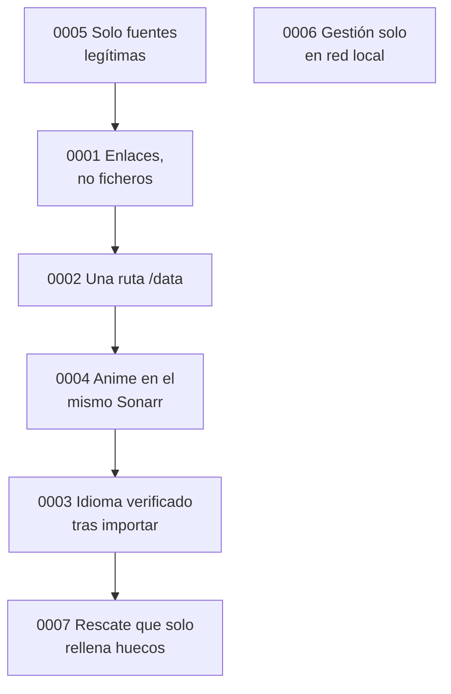

# Registro de decisiones

Cada fichero recoge una decisión importante con el formato de Michael Nygard: contexto, decisión y consecuencias (las buenas, las malas y las neutras, juntas para no esconder ningún coste). Añado las alternativas descartadas, porque en varias el "no" fue tan importante como el "sí".

Las decisiones aceptadas no se editan. Si cambian, se escribe una nueva que sustituye a la anterior y la vieja lo indica en su estado.

| # | Decisión | Estado |
|---|---|---|
| [0000](0000-registrar-decisiones.md) | Registrar las decisiones | Aceptada |
| [0001](0001-enlaces-no-ficheros.md) | Enlaces a un servicio en la nube, no ficheros en el disco | Aceptada, con la descarga local como alternativa documentada |
| [0002](0002-una-ruta-data.md) | Una sola carpeta montada como `/data` en todos | Aceptada |
| [0003](0003-idioma-verificado-tras-importar.md) | Verificar el idioma abriendo el fichero tras importarlo | Aceptada |
| [0004](0004-anime-en-el-mismo-sonarr.md) | El anime en el mismo Sonarr, con su carpeta y su perfil | Aceptada |
| [0005](0005-solo-fuentes-legitimas.md) | Solo fuentes legítimas, y la guía no nombra otras | Aceptada |
| [0006](0006-gestion-solo-en-red-local.md) | Las apps de gestión, solo en la red local | Aceptada |
| [0007](0007-rescate-solo-rellena-huecos.md) | El rescate de importaciones solo rellena huecos | Aceptada, sustituye a una primera versión que podía sustituir ficheros |

---

Anterior: [Otros idiomas](../10-otros-idiomas.md) · Volver al [inicio](../../README.md)
